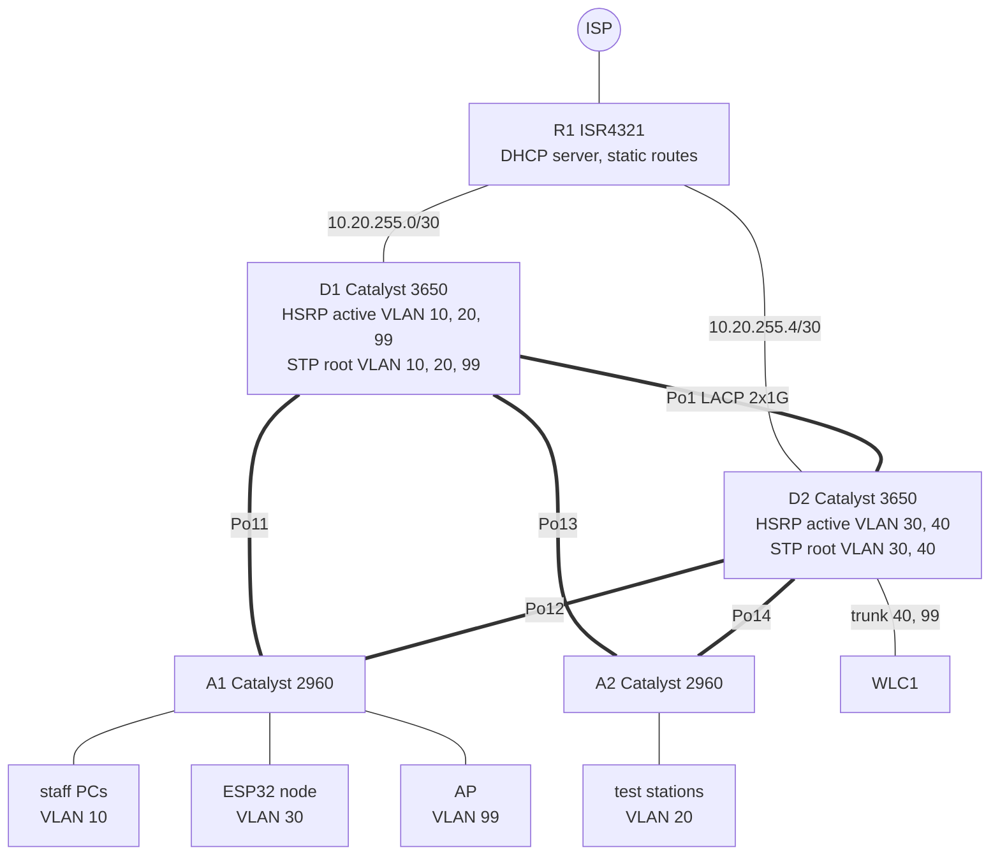

# CCNA Campus Network

[](https://github.com/HannaBeshoy/ccna-campus-network/actions/workflows/ci.yml)

**Programming Network Devices 1 course project (Cisco CCNA: Switching, Routing and Wireless Essentials)** · University of Debrecen, Faculty of Informatics · Cisco IOS, Python · **configurations generated and checked offline; Packet Tracer build and lab test on the Cisco switches next**

The network of a small factory test hall, designed the way the SRWE course builds one, module by module: VLANs, trunks, inter-VLAN routing on Layer 3 switches, Rapid PVST+, EtherChannel, DHCPv4 with relays, SLAAC and stateless DHCPv6, HSRP for the default gateway, switch security, a wireless LAN on a controller, and static routing with a floating backup route. The whole network is described in one file, [network.yaml](network.yaml); a Python tool generates the IOS configuration of all five devices from it, checks the design for mistakes, checks every configuration against a security policy, predicts the spanning-tree result, and on the lab day reads the show-command output from the real switches and says what matches the design and what does not.

- [x] [network.yaml](network.yaml): 6 VLANs, IPv4 and IPv6 addressing, 5 LACP EtherChannels, HSRP and STP roots per VLAN, DHCP pools and a reservation for the ESP32 sensor node
- [x] `python -m campus generate`: [configs/](configs/) for R1, D1, D2, A1, A2 (790 lines of IOS), with password placeholders; real passwords come from a local `secrets.yaml` that is never committed
- [x] `python -m campus check`: about 30 checks for design mistakes (overlapping subnets, a port used twice, mismatched EtherChannel ends, an access switch without two uplinks, an unassigned port, ...)
- [x] `python -m campus lint`: the switch-security policy of modules 10 and 11 on any config file, generated or saved from a real switch
- [x] `python -m campus stp`: which Port-channel is root, designated or blocking in every VLAN, before anything is cabled
- [x] `python -m campus diff` and `verify`: compare a running-config and saved show commands with the design
- [x] **43 tests pass** in CI, and CI fails if the committed configs differ from what the model generates
- [ ] Packet Tracer build ([steps](docs/PACKET_TRACER.md)) and the test on the lab's Cisco switches ([test sheet](docs/LAB_DAY.md))

## Topology



| VLAN | Name | IPv4 | IPv6 | Gateway: HSRP active |
| ---: | --- | --- | --- | --- |
| 10 | STAFF | 10.20.10.0/24 | 2001:db8:acad:10::/64 | D1 |
| 20 | PRODUCTION | 10.20.20.0/24 | 2001:db8:acad:20::/64 | D1 |
| 30 | IOT | 10.20.30.0/24 | 2001:db8:acad:30::/64 (SLAAC + stateless DHCPv6) | D2 |
| 40 | WIFI | 10.20.40.0/24 | 2001:db8:acad:40::/64 | D2 |
| 99 | MGMT | 10.20.99.0/24 | 2001:db8:acad:99::/64 | D1 |
| 999 | PARKING | unused ports, native VLAN of every trunk | | |

The full addressing plan is generated into [docs/ADDRESSING.md](docs/ADDRESSING.md).

## Design decisions

| Decision | Why | Module |
| --- | --- | --- |
| The STP root and the HSRP active router of a VLAN are the same switch | otherwise frames to the gateway cross the inter-switch link for nothing; `primary:` in the YAML sets both, so they cannot drift apart | 5, 9 |
| Two distribution switches share the load: D1 for VLANs 10, 20, 99, D2 for 30, 40 | both uplinks of every access switch carry traffic, each for some VLANs | 5, 9 |
| Every link between switches is a 2-member LACP EtherChannel | a cable can fail without STP reconverging, and STP sees one link instead of two | 6 |
| Routing on the Layer 3 switches (SVIs), routed uplinks to R1 | inter-VLAN traffic never leaves the distribution layer; no router-on-a-stick bottleneck | 4, 14 |
| DHCP server on R1, relays on the SVIs | one place for all pools; the relay fills in giaddr so the server picks the right pool | 7 |
| R1 reaches the campus by one summary route, with a floating static (AD 10) through D2 | one line instead of five, and an automatic backup when D1's link fails | 15 |
| A /32 host route to the WLC through D2 | longest match beats the summary, so controller traffic goes straight to the switch it hangs off | 14, 15 |
| Native VLAN 999 on every trunk, DTP off, unused ports shut down in VLAN 999 | stops VLAN hopping (double tagging and switch spoofing) | 10, 11 |
| Port security (sticky), PortFast + BPDU guard, DHCP snooping with rate limit, Dynamic ARP Inspection on every access port | MAC flooding, rogue switches, rogue DHCP servers and ARP spoofing are each blocked by one of these | 11 |
| SSH version 2 only, local users with `secret`, `service password-encryption` | no plain-text management traffic or stored passwords | 1, 10 |
| Passwords are placeholders in the repository | a configuration in a public repository must not carry real credentials | |

## Spanning tree, predicted

`python -m campus stp` runs the four steps of module 5 on the design (Cisco short path costs: a 2×100 Mb/s EtherChannel costs 12, 2×1 Gb/s costs 3):

```text
VLAN 10: root bridge D1                    VLAN 30: root bridge D2
  A1  Po11  Root FWD                         A1  Po11  Altn BLK
  A1  Po12  Altn BLK                         A1  Po12  Root FWD
  D2  Po1   Root FWD                         D1  Po1   Root FWD
  D2  Po12  Desg FWD                         D1  Po11  Desg FWD
```

In every VLAN exactly one uplink of each access switch blocks, the one towards the switch that is not that VLAN's root, and no port of the distribution layer blocks. No decision depends on a MAC address, so the real switches must show the same roles; `verify` checks this on the lab day.

## Running it

```bash
pip install -r requirements.txt
python -m campus check                 # the design
python -m campus generate              # configs/*.cfg (placeholders)
cp secrets.example.yaml secrets.yaml   # set real lab passwords, then:
python -m campus generate --out build  # ready-to-paste configs in build/ (not committed)
python -m campus lint configs/*.cfg
python -m campus stp
python -m campus diff A1 saved_running_config.txt
python -m campus verify captures       # show-command outputs from the lab
python -m pytest -v tests
```

## Repository layout

```text
network.yaml        the design
campus/             model and checks, generator, policy lint, running-config diff, STP prediction, lab verifier
templates/          Jinja2 templates of the router, distribution and access configurations
configs/            the generated configurations
docs/               project guide (module by module), addressing plan, Packet Tracer steps, lab-day test sheet
tests/              43 tests; fixtures/lab holds hand-written show outputs in IOS format
captures/           where the real lab-day outputs go
```

The [project guide](docs/PROJECT_GUIDE.md) explains each part with the SRWE module it comes from.

## Author

Beshoy Hanna · Computer Science Engineering BSc, University of Debrecen · [LinkedIn](https://www.linkedin.com/in/beshoy-hanna-8b52213a0)
