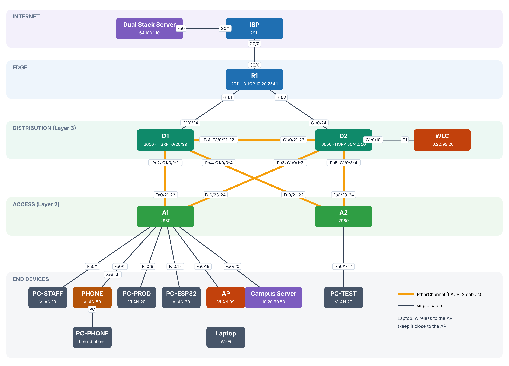

# Packet Tracer file

`campus.pkt` is the whole campus network of this repository, built and tested in Cisco Packet Tracer.

## Packet Tracer versions

Saved in Packet Tracer 9.0.1. It also opens in the older Packet Tracer version used on the second lab computer.
If you change the file, check that it still opens in both versions before you commit it
(docs/PACKET_TRACER.md, "Save the .pkt file").

## What is in the file

| Tier | Devices |
| --- | --- |
| Internet | ISP (2911) and the Dual Stack Server 64.100.1.10 / 2001:db8:100:1::a |
| Edge | R1 (2911): default route to the ISP, DHCP server on Loopback0 10.20.254.1 for every VLAN, floating routes |
| Distribution | D1 and D2 (3650): SVIs with HSRP v2 (IPv4 and IPv6), D1 active for VLANs 10/20/99, D2 for 30/40/50; WLC-2504 on D2 G1/0/10 |
| Access | A1 and A2 (2960): access ports, voice VLAN 50 on the staff desk ports, port security, PortFast and BPDU guard |
| End devices | PC-STAFF (VLAN 10), PC-PROD and PC-TEST (VLAN 20), PC-ESP32 (VLAN 30), IP phone 7960 with PC-PHONE behind it (VLANs 50 and 10), the AP with a laptop on HU01-STAFF, the campus server 10.20.99.53 (DNS, RADIUS, DHCP for the AP) |

Five LACP EtherChannels (Po1 D1-D2, Po2 D1-A1, Po3 D2-A1, Po4 D1-A2, Po5 D2-A2) carry VLANs 10, 20, 30, 40, 50 and 99
with native VLAN 999. The file follows the design in `network.yaml` with the Packet Tracer differences listed in
docs/PACKET_TRACER.md: DHCP snooping and DAI off on A1/A2, the WLC management VLAN untagged, Wi-Fi clients in VLAN 99,
and no ESP32 reservation pool on R1.

## Logins

These passwords exist only in this Packet Tracer file; they are not used on any real device, and the
configs in `configs/` keep their `<PLACEHOLDER>` values.

| Where | Login |
| --- | --- |
| R1, D1, D2, A1, A2 (console and SSH) | user `admin`, password `Lab-Admin1`, enable `Lab-Enable1` |
| ISP | no login |
| WLC web page `https://10.20.99.20` | user `admin`, password `Lab-Admin1` |
| RADIUS shared secret (WLC and campus server) | `Radius-Lab1` |
| Wi-Fi user on HU01-STAFF (WPA2-Enterprise) | `staff1` / `Staff-Lab1` |

## Running the tests

1. Open the file and wait about a minute (click Fast Forward Time) for spanning tree, LACP and HSRP to settle.
   After the file opens, the PCs need DHCP once more (IP Configuration, Static, then DHCP), and IPv6 PCs need
   Static, then Automatic, for SLAAC.
2. Run the checks in docs/PACKET_TRACER.md section 5: bundles, HSRP, DHCP for every VLAN, ping and tracert to the
   Dual Stack Server, the two failovers and port security.
3. Save the show outputs as `captures/pt/<device>_<command>.txt` (spaces as underscores) and run
   `python -m campus verify captures/pt`. The saved captures give 39 passed, 0 failed.
